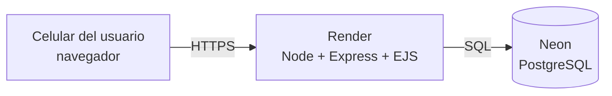

# Plan técnico

Se deriva de la [especificación](comportamientos.md) y de la alternativa elegida en el Módulo 2.

## 1. Alternativa seleccionada

**B – Formulario web adaptado a móvil + base de datos.** Obtuvo 105 puntos frente a 85 (C, CRM gratuito) y
57 (A, app nativa) en la matriz del Módulo 2. Se eligió por cuatro hechos del cliente:

- **Techo de $150.000/mes** (y tres meses para gestionar más con un cooperante): B cabe en ese costo, A no.
- **4 de 14 comercios usan teléfono básico o comparten uno:** una web no necesita instalación; una app nativa sí.
- **Voluntarios con datos limitados (varios en prepago):** páginas livianas, sin imágenes pesadas.
- **Sin personal técnico en la fundación:** la alternativa se diseña a la medida y es simple de mantener.

C ganaba en factibilidad y costo, pero un CRM está pensado para ventas y no permite trazar
donante → voluntario → receptor → cantidad → hora, ni resolver el doble conteo.

## 2. Arquitectura

Aplicación web **Node.js 20 + Express** que genera las páginas en el servidor con **EJS**. HTML y CSS livianos,
sin frameworks de interfaz ni imágenes pesadas (RNF-02 consumo de datos, RNF-07 red 3G). Base de datos
**PostgreSQL**.

| Decisión | Justificación |
|---|---|
| Páginas generadas en el servidor (EJS) | Alternativa B y RNF-02/07: poco JavaScript en el celular, carga rápida en 3G. |
| PostgreSQL | La regla de «solo uno toma» necesita una actualización atómica en base de datos real (ADR-001). |
| Render + Neon gratis | Techo de $150.000/mes y RNF-06 (ADR-002). |
| Nombre + PIN | RNF-03 y «un rol por tipo de actor basta» (ADR-003). |
| Sesiones guardadas en la base de datos | Un reinicio de Render (plan gratis) no saca a todos los usuarios. |

## 3. Modelo de datos

- **`usuarios`**: id, nombre, rol (`donante` | `voluntario` | `coordinadora`), pin_hash, zona, direccion (para donantes).
- **`organizaciones`**: id, nombre, direccion, zona, refrigeracion.
- **`donaciones`**: id, codigo, tipo_alimento, cantidad, unidad, punto_recogida, zona, hora_limite,
  estado (`disponible` | `asignada` | `entregada`), donante_id, registrada_por_id, creada_en,
  voluntario_id, tomada_en, organizacion_id, recibido_por, entregada_en.
- **`movimientos`**: id, donacion_id, tipo (`registro` | `toma` | `entrega` | `liberacion`), usuario_id,
  ocurrido_en, detalle. Da la trazabilidad sanitaria (RNF-05): quién, qué, cuándo. `liberacion` (CMP-06) se
  agregó en la 3C.
- En la 3C, `donaciones` gana `id_local` (texto único, opcional): el identificador que genera el teléfono para
  que enviar dos veces una donación guardada sin conexión no la duplique (CMP-08).

«Vencida» **se calcula, no se guarda**: es una donación `disponible` con `hora_limite` cumplida.

Con la administración (CMP-09 a CMP-15) el modelo gana:

- **`zonas`** (CMP-09): id, nombre (único sin importar mayúsculas), activa. Las columnas `zona` de usuarios,
  organizaciones y donaciones siguen siendo texto con el nombre: la lista controla qué se puede elegir y renombrar
  una zona actualiza las tres tablas en una sola transacción.
- **`usuarios`** (CMP-10 y CMP-11): telefono, activo, debe_cambiar_pin (PIN temporal pendiente), creado_en.
- **`organizaciones`** (CMP-12): telefono, activa.
- **`donaciones`** (CMP-13): estado `cancelada`, motivo_cancelacion, cancelada_en.
- **`movimientos`**: tipos `correccion` y `cancelacion` (CMP-13) y `asignacion` (CMP-14). La liberación por la
  coordinadora usa `liberacion` con un detalle que dice a quién se la quitó.

Nada se borra: usuarios, zonas y organizaciones se **desactivan**, porque el historial apunta a ellos (RNF-05).

Con la seguridad y los requerimientos que faltaban (CMP-16 a CMP-23):

- **`usuarios`**: privacidad_aceptada_en (CMP-18), rol `organizacion` y organizacion_id (CMP-19).
- **`intentos_ingreso`** (CMP-16): clave (`nombre:<nombre escrito>` u `origen:<dirección IP>`), fallos, desde cuándo se
  cuentan y bloqueado_hasta. Se cuenta por el nombre **escrito**, exista o no el usuario, para que el bloqueo no revele
  qué nombres existen (CA-16.6). Vive en la base para que un reinicio de Render no borre el conteo.
- **`donaciones`**: destino_organizacion_id (CMP-19), kg_aproximados (CMP-22).
- **`movimientos`**: tipos `solicitud` y `retiro_solicitud` (CMP-19).
- **`atenciones`** (CMP-20): id, organizacion_id, fecha, personas, registrada_por_id, registrada_en, corregida_por_id,
  corregida_en. **Única por (organizacion_id, fecha)**: es lo que impide el doble conteo.
- **`fotos_donacion`** (CMP-23): donacion_id, tipo, datos (bytea), bytes. Ver ADR-007.

## 4. Integraciones

Ninguna externa obligatoria: sin mapas, sin SMS, sin notificaciones. Por costo, y porque la geolocalización
no era un requisito real (Módulo 2): basta filtrar por zona.

## 5. Entorno y despliegue

- **Desarrollo local:** Node 20 + PostgreSQL (con Docker si está instalado; si no, una base de desarrollo en Neon).
- **Producción:** Render (plan gratis) + Neon (plan gratis) = **$0/mes** (RNF-06).
- **Pruebas:** GitHub Actions corre Jest + Supertest en cada pull request contra un PostgreSQL de servicio.
- **Variables de entorno:** `DATABASE_URL`, `SESSION_SECRET`, `TZ=America/Bogota`, `NODE_ENV`. Van en `.env`
  (ignorado por git); en el repo solo está `.env.example` con valores falsos.
- **Arranque seguro (T-ADM.3):** en producción el servidor **no** carga la semilla de demostración (sus PIN son
  públicos en el README). Al arrancar aplica las migraciones y, si no hay ninguna coordinadora activa, crea la
  primera con `PRIMERA_COORDINADORA_NOMBRE` y `PRIMERA_COORDINADORA_PIN` (variables que se escriben en Render,
  nunca en el repositorio); esa persona debe cambiar el PIN al entrar (CA-11.4). El plan gratis de Render no tiene
  consola, por eso se hace con variables y no con un comando. La semilla se niega a correr con
  `NODE_ENV=production`.

## 6. Identificación de usuarios

Nombre + PIN de 4 dígitos, con sesión por cookie. Ver [ADR-003](../decisiones/ADR-003-identificacion-nombre-pin.md).
La coordinadora crea usuarios y restablece PIN con un PIN temporal que la persona cambia al entrar; desactivar,
editar o restablecer cierra las sesiones abiertas de esa persona. Ver
[ADR-005](../decisiones/ADR-005-administracion-pin-temporal.md).

## 7. Riesgos del Módulo 2 convertidos en decisiones o tareas

| Riesgo o restricción | Decisión o tarea |
|---|---|
| **Técnico:** sin señal no se puede registrar. | El MVP minimiza datos y pasos. En la 3C se agregó el modo sin conexión para registrar (CMP-08, tarea **T-3C.1**): cola en el teléfono y sincronización repetible, ver [ADR-004](../decisiones/ADR-004-modo-sin-conexion.md). CA-03.5 (reintento sin duplicar) ya protege contra la mala señal al tomar. |
| **Contexto:** siguen usando WhatsApp en paralelo. | Tarea de la 3C: manual de operación y mensaje de lanzamiento para Marcela («solo cuenta lo registrado»). |
| **Restricción:** nadie pesa el alimento. | La cantidad se guarda como **declarada**, con unidad; no se presenta como verificada. |

## 8. Desviaciones de la alternativa

Ninguna. Si aparece alguna, se argumenta en esta sección.

## Decisiones de arquitectura (ADR)

- [ADR-001 · Un solo voluntario toma cada donación](../decisiones/ADR-001-toma-atomica.md)
- [ADR-002 · Hosting y base de datos: Render + Neon](../decisiones/ADR-002-hosting-render-neon.md)
- [ADR-003 · Identificación con nombre + PIN](../decisiones/ADR-003-identificacion-nombre-pin.md)
- [ADR-004 · Registrar sin conexión con una cola en el teléfono](../decisiones/ADR-004-modo-sin-conexion.md)
- [ADR-005 · Administración por la coordinadora con PIN temporal](../decisiones/ADR-005-administracion-pin-temporal.md)
- [ADR-006 · Seguridad básica: intentos, origen de los formularios, cabeceras y errores](../decisiones/ADR-006-seguridad-basica.md)
- [ADR-007 · Fotos achicadas en el teléfono y guardadas en la base de datos](../decisiones/ADR-007-fotos-en-la-base-de-datos.md)

## Tareas de la administración

| Tarea | Comportamiento | Rama |
|---|---|---|
| T-ADM.2 · Especificación de la administración | CMP-09 a CMP-15 | `docs/especificacion-administracion` |
| T-09.1 · Catálogo de zonas | CMP-09 | `feat/CMP-09-zonas` |
| T-10.1 · Administrar usuarios | CMP-10 | `feat/CMP-10-usuarios` |
| T-11.1 · Cambiar y restablecer el PIN | CMP-11 | `feat/CMP-11-pin` |
| T-12.1 · Administrar organizaciones | CMP-12 | `feat/CMP-12-organizaciones` |
| T-13.1 · Corregir o cancelar una donación | CMP-13 | `feat/CMP-13-corregir-cancelar` |
| T-14.1 · Intervención de la coordinadora | CMP-14 | `feat/CMP-14-intervencion` |
| T-15.1 · Teléfono de contacto | CMP-15 | `feat/CMP-15-contacto` |
| T-ADM.3 · Arranque seguro en producción | Sección 5 | `infra/arranque-seguro` |
| T-ADM.4 · Manual de operación actualizado | — | `docs/manual-administracion` |

## Tareas de seguridad y requerimientos pendientes

| Tarea | Comportamiento | Rama |
|---|---|---|
| T-SEG.0 · Especificación de seguridad y requerimientos | CMP-16 a CMP-23, T-SEG.1, T-SEG.2 | `docs/especificacion-seguridad-requerimientos` |
| T-16.1 · Límite de intentos de ingreso | CMP-16 | `feat/CMP-16-intentos` |
| T-SEG.1 · Formularios de otros sitios y cabeceras | T-SEG.1 | `infra/T-SEG.1-cabeceras` |
| T-SEG.2 · Registro de errores con código | T-SEG.2 | `infra/T-SEG.2-errores` |
| T-17.1 · Nombres de usuario distinguibles | CMP-17 | `feat/CMP-17-nombres` |
| T-18.1 · Aviso de privacidad | CMP-18 | `feat/CMP-18-privacidad` |
| T-19.1 · Organizaciones con usuario | CMP-19 | `feat/CMP-19-organizaciones-usuarias` |
| T-20.1 · Personas atendidas | CMP-20 | `feat/CMP-20-personas-atendidas` |
| T-21.1 · Por vencer y WhatsApp | CMP-21 | `feat/CMP-21-por-vencer` |
| T-22.1 · Kilos aproximados | CMP-22 | `feat/CMP-22-kilos` |
| T-23.1 · Foto opcional | CMP-23 | `feat/CMP-23-foto` |
| T-SEG.3 · Manual de operación actualizado | — | `docs/manual-seguridad-requerimientos` |
