# Pantallas del MVP

Artefacto del UX Designer (Fabio Jordan). Lista las pantallas reales del MVP, con el comportamiento (CMP) y los
criterios de aceptación (CA) que cubre cada una. Derivadas de los wireframes del Módulo 1.

Las capturas son de la aplicación funcionando, en vista de celular (360 × 760 px), con los datos de la semilla de
demostración, tomadas el 28 de octubre de 2026.

## Principios de diseño

Se eligieron por quienes usan el sistema: comerciantes ocupados, voluntarios que revisan el celular por bloques y
personas con poca familiaridad tecnológica (Módulo 1).

- **Pocos pasos (RNF-03).** Desde la pantalla de partida: publicar una donación son 3 pasos (abrir, llenar, enviar);
  tomarla son 2 (pulsar «Tomar», confirmar); registrar su entrega son 3 (pulsar «Registrar entrega», llenar, confirmar).
- **Livianas (RNF-02 y RNF-07).** Las páginas se generan en el servidor con HTML y CSS; no llevan JavaScript ni
  imágenes, para que carguen rápido con datos limitados o red 3G.
- **Móvil primero.** Una sola columna, campos y botones grandes (alto mínimo de 48 px) y texto de 17,6 px.
- **Errores claros y junto al campo.** El mensaje dice qué falta y la pantalla conserva lo ya escrito (CA-01.2, CA-04.3).
- **El estado no depende solo del color.** Siempre va escrito («Disponible», «Asignada», «Entregada», «Vencida (no
  recogida)»); el color solo refuerza.
- **Confirmar antes de tomar.** En el MVP un voluntario no puede soltar una donación (decisión de alcance de CMP-03),
  por eso «Tomar» pide una confirmación.
- **Todo en español**, con las palabras del caso (donación, recogida, comercio).

## Mapa de navegación por rol

| Rol | Pantallas a las que llega desde el inicio |
|---|---|
| Donante (comercio) | Publicar donación · Mis donaciones · Buscar donación |
| Voluntario | Donaciones disponibles → Tomar → Mis recogidas → Registrar entrega · Buscar donación |
| Coordinadora | Registrar donación de un comercio · Todas las donaciones · Buscar donación |

Todas las pantallas del detalle de una donación están a un enlace de distancia («Ver estado e historial»).

## Pantallas

### Ingreso (todos los roles)
Entrada con nombre y PIN de 4 números ([ADR-003](../decisiones/ADR-003-identificacion-nombre-pin.md)). El mensaje de
error es el mismo si falla el nombre o el PIN.

| | |
|---|---|
| Ruta | `/ingreso` |
| CMP / CA | Habilitador (RNF-03, RNF-04); sin CA propio |

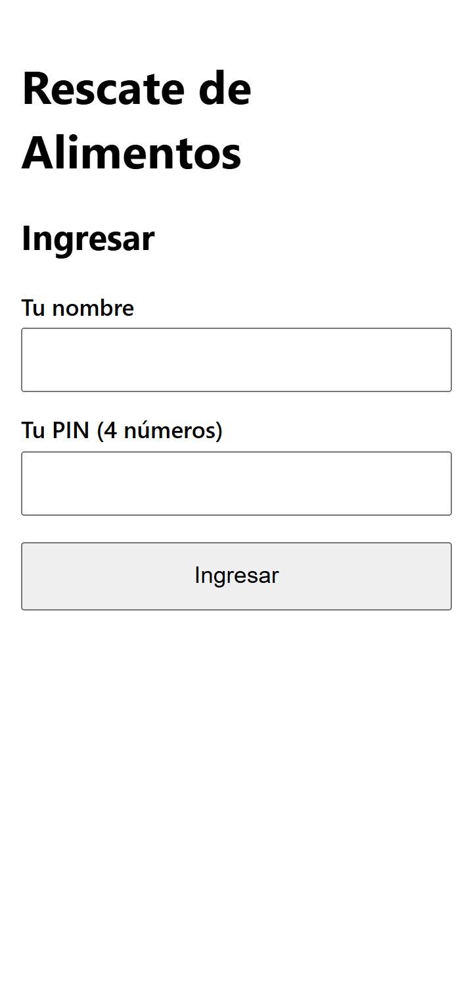
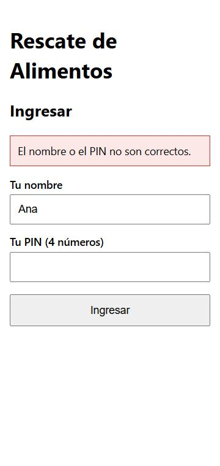

### Inicio (según el rol)
Muestra solo lo que el rol puede hacer. Ejemplos: el donante y el voluntario.

| | |
|---|---|
| Ruta | `/` |
| CMP / CA | Acceso por rol (RNF-04) |

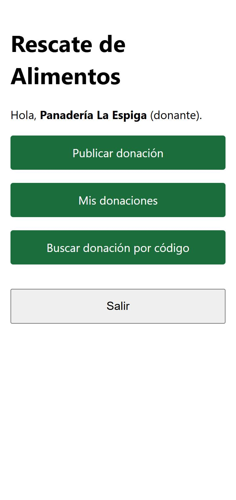
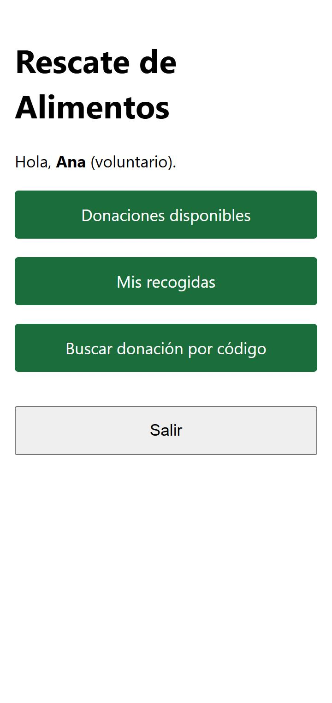
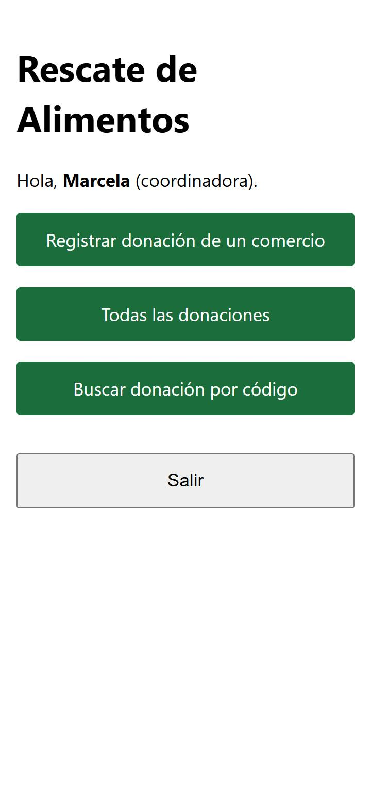

### Publicar donación (donante)
Una sola pantalla con los 4 datos obligatorios (la unidad va con la cantidad). El punto de recogida viene con la
dirección del comercio y se puede cambiar.

| | |
|---|---|
| Ruta | `/donaciones/nueva` |
| CMP / CA | CMP-01 · CA-01.1, CA-01.6 |

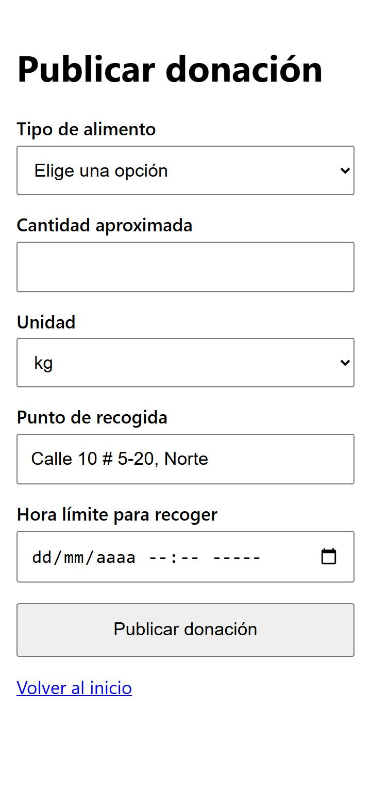

### Publicar donación con errores (donante)
Si falta un dato, la hora límite ya pasó o la cantidad no sirve, no se registra nada: cada mensaje queda bajo su campo
y se conserva lo escrito.

| | |
|---|---|
| Ruta | `/donaciones` (al enviar con errores) |
| CMP / CA | CMP-01 · CA-01.2, CA-01.3, CA-01.4 |

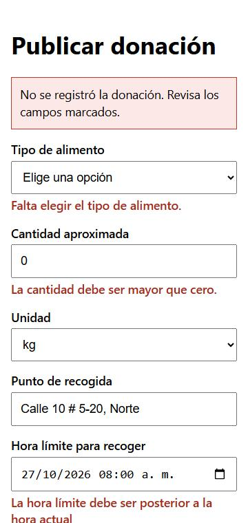

### Donación registrada (donante)
Confirma y muestra el código (por ejemplo D-0005) con el estado «disponible».

| | |
|---|---|
| Ruta | `/donaciones/:codigo/registrada` |
| CMP / CA | CMP-01 · CA-01.1 |

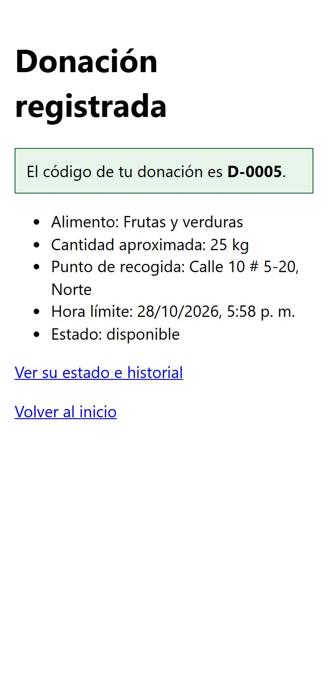

### Registrar donación de un comercio (coordinadora)
El mismo formulario, con un selector «Comercio que avisó la donación». Sirve para los comercios con teléfono básico
que avisan por llamada. La donación queda a nombre del comercio y con la coordinadora como «registrada por».

| | |
|---|---|
| Ruta | `/donaciones/nueva` (con el rol coordinadora) |
| CMP / CA | CMP-01 · CA-01.5 |

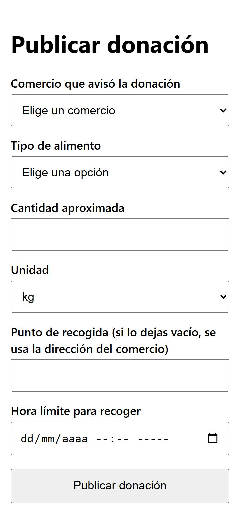

### Mis donaciones (donante)
Cada donación con su estado, para que el comercio sepa que alguien va por ella.

| | |
|---|---|
| Ruta | `/mis-donaciones` |
| CMP / CA | CMP-05 · CA-05.6 |

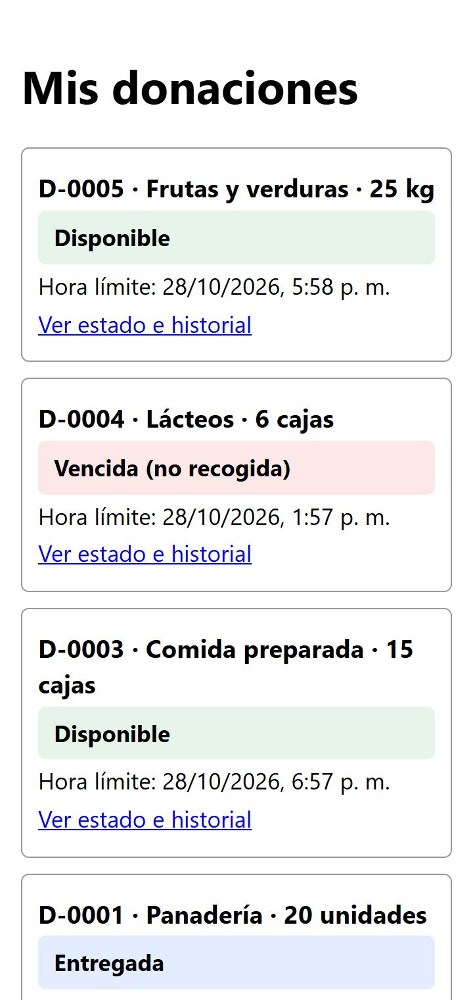

### Donaciones disponibles (voluntario)
Solo las vigentes, de la más urgente a la menos urgente, con el tiempo que queda. Por defecto muestra la zona del
voluntario y permite pasar a «Todas las zonas».

| | |
|---|---|
| Ruta | `/disponibles` |
| CMP / CA | CMP-02 · CA-02.1, CA-02.2, CA-02.3, CA-02.5 |

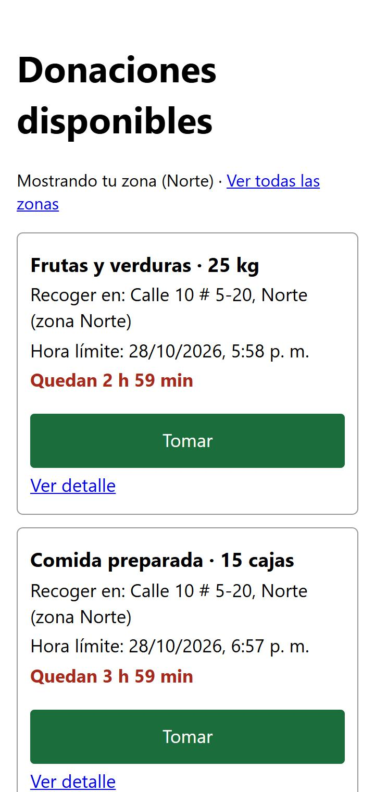

### Confirmar toma (voluntario)
Resume la donación y pide confirmar antes de tomarla.

| | |
|---|---|
| Ruta | `/donaciones/:codigo/tomar` |
| CMP / CA | CMP-03 · CA-03.1 |

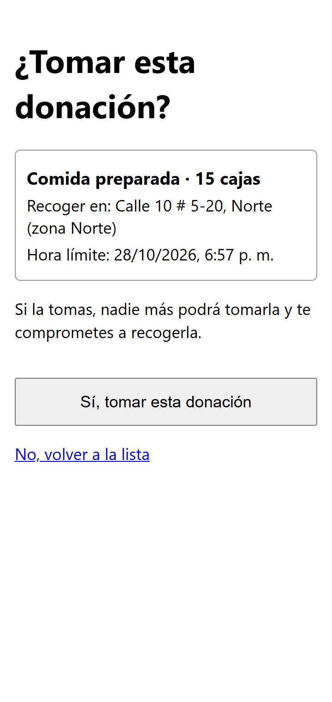

### Donación tomada (voluntario)
Muestra el punto de recogida y la hora límite. Si quien vuelve a pulsar «Tomar» ya la había tomado, esta misma pantalla
dice «Ya tomaste esta donación» (CA-03.5).

| | |
|---|---|
| Ruta | `/donaciones/:codigo/tomada` |
| CMP / CA | CMP-03 · CA-03.1, CA-03.5 |

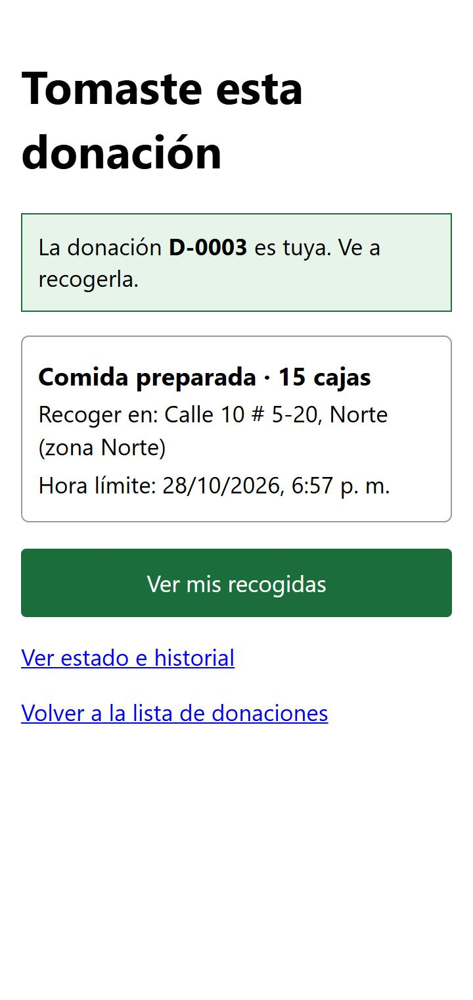

### No se pudo tomar (voluntario)
Para quien llega tarde: dice quién la tomó y a qué hora, y que no vaya al punto de recogida. También cubre la hora
límite vencida (CA-03.4).

| | |
|---|---|
| Ruta | `/donaciones/:codigo/tomar` (cuando ya no está disponible) |
| CMP / CA | CMP-03 · CA-03.2, CA-03.3, CA-03.4 |

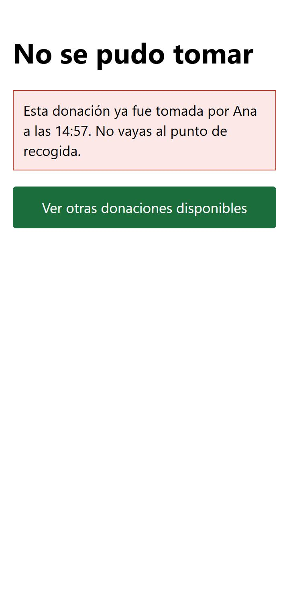

### Mis recogidas (voluntario)
Las donaciones que el voluntario tomó y todavía no entregó, con el botón «Registrar entrega».

| | |
|---|---|
| Ruta | `/mis-recogidas` |
| CMP / CA | CMP-03 · CA-03.1 |

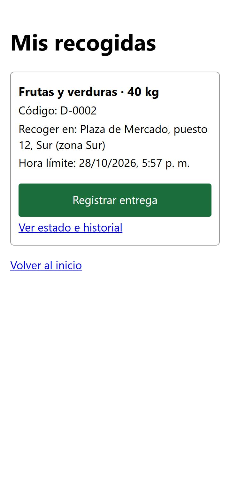

### Registrar entrega (voluntario)
Se elige la organización que recibe y se escribe el nombre de quien recibe. La fecha y la hora las pone el servidor.

| | |
|---|---|
| Ruta | `/donaciones/:codigo/entregar` |
| CMP / CA | CMP-04 · CA-04.1, CA-04.2, CA-04.3, CA-04.4, CA-04.5, CA-04.6 |

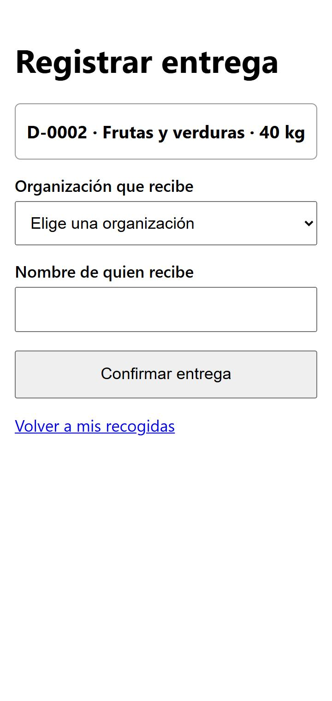

### Detalle de una donación (todos los roles)
Estado actual, datos de la donación e historial en orden: quién la registró, quién la tomó y a quién se entregó.
Una donación disponible con la hora límite cumplida aparece como «Vencida (no recogida)».

| | |
|---|---|
| Ruta | `/donaciones/:codigo` |
| CMP / CA | CMP-05 · CA-05.1, CA-05.2, CA-05.3 · CMP-02 · CA-02.4 |

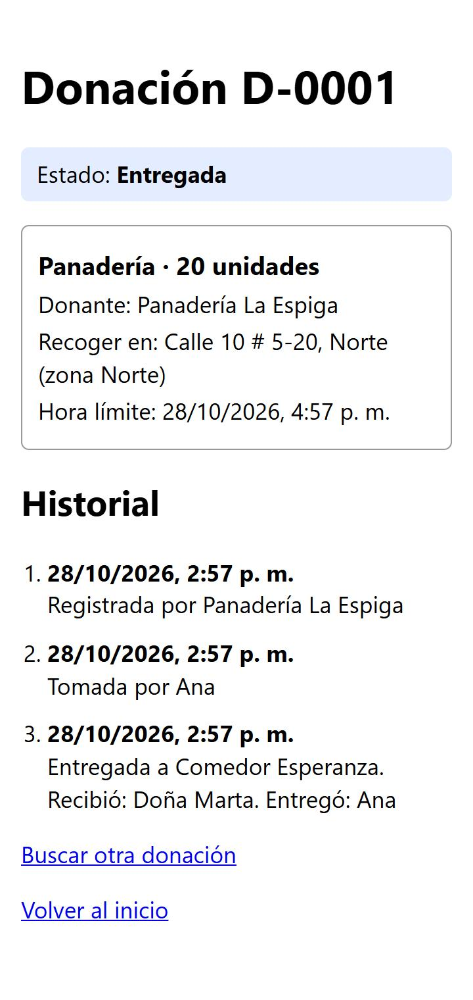

### Buscar donación (todos los roles)
Búsqueda por código. Entiende `D-0012`, `d-12` y `12`. Si el código no existe, lo dice.

| | |
|---|---|
| Ruta | `/buscar` |
| CMP / CA | CMP-05 · CA-05.1, CA-05.4 |

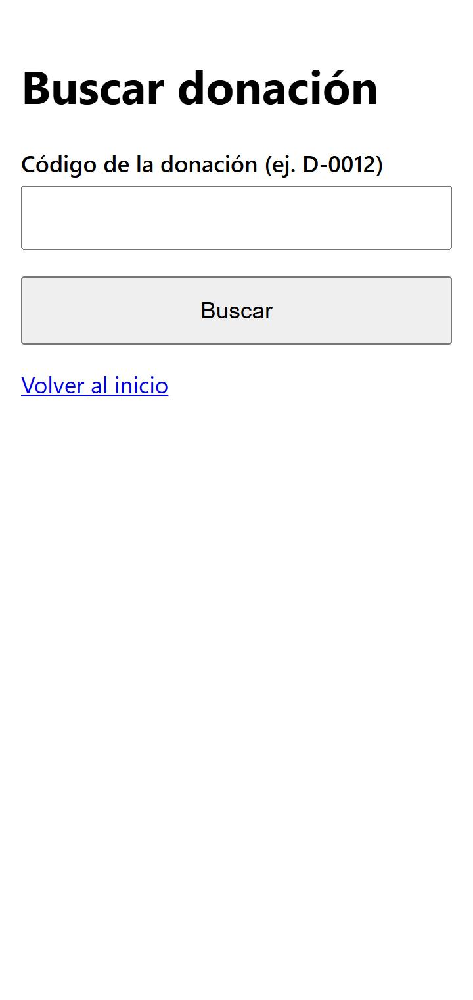

### Todas las donaciones (coordinadora)
Todas las donaciones, de la más reciente a la más antigua, con filtro por estado (disponibles, asignadas, entregadas
y vencidas).

| | |
|---|---|
| Ruta | `/todas` |
| CMP / CA | CMP-05 · CA-05.5 |

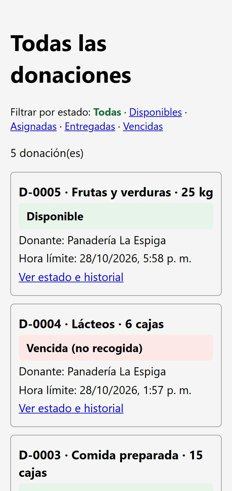

## Relación con los wireframes del Módulo 1

| Wireframe del Módulo 1 | En el MVP |
|---|---|
| 1. Publicar donación (Donante) | Construida: «Publicar donación» |
| 2. Donaciones cercanas (Organización receptora) | No se construyó: las organizaciones receptoras son datos y no inician sesión en el MVP (ver «Actores» en la especificación). El equivalente para el voluntario es «Donaciones disponibles». |
| 3. Mis recogidas de hoy (Voluntario) | Construida: «Mis recogidas». Muestra todas las pendientes, no solo las de hoy. |
| 4. Reporte del periodo (Fundación) | Fuera del alcance del MVP (RF-07); queda en el backlog de la 3C. |

## Limitaciones conocidas

- **Tema oscuro.** Los estilos no fijan el color de fondo ni del texto. Al capturar, una de las pantallas salió con texto
  negro sobre fondo oscuro cuando el navegador estaba en tema oscuro. Se corrige en un PR aparte.
- **Hora límite.** Usa el selector de fecha y hora del propio navegador. No se probó en teléfonos reales, solo en la vista
  de celular del navegador.
- **Capturas.** Salen del entorno local con datos de demostración, no de la URL desplegada.
